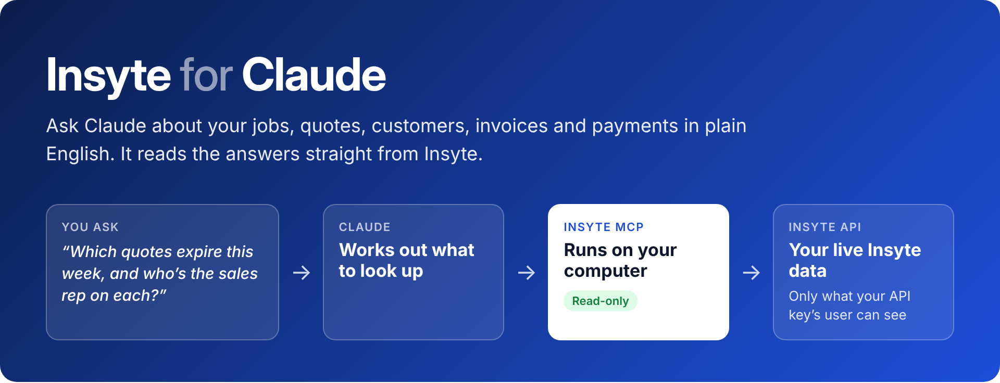
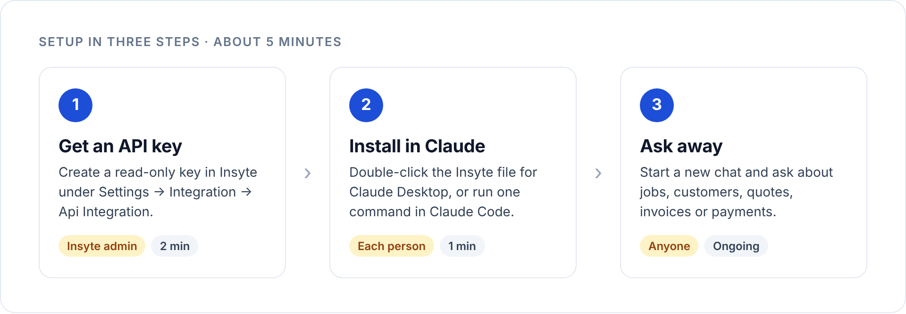
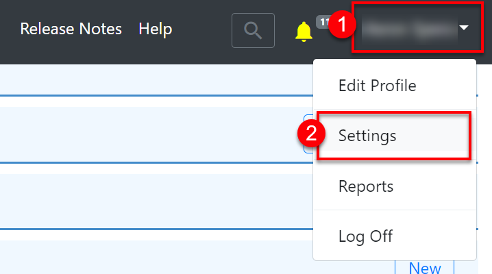
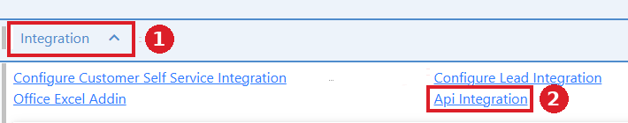
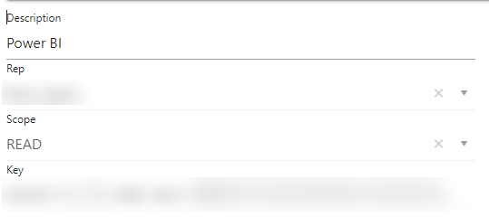
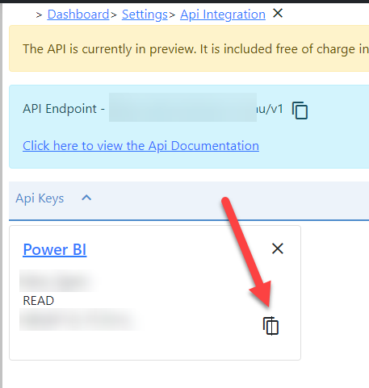
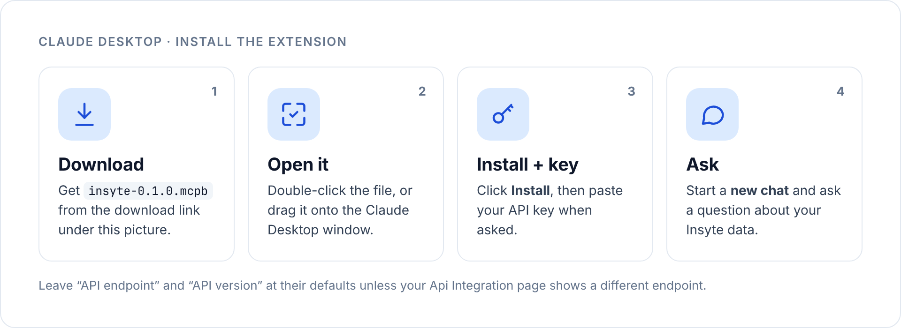
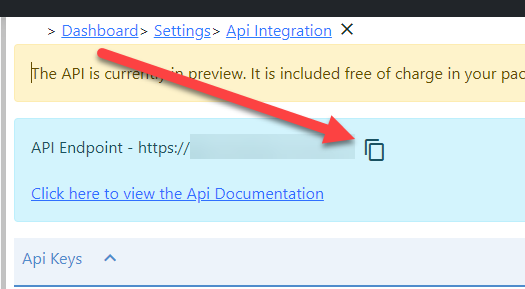
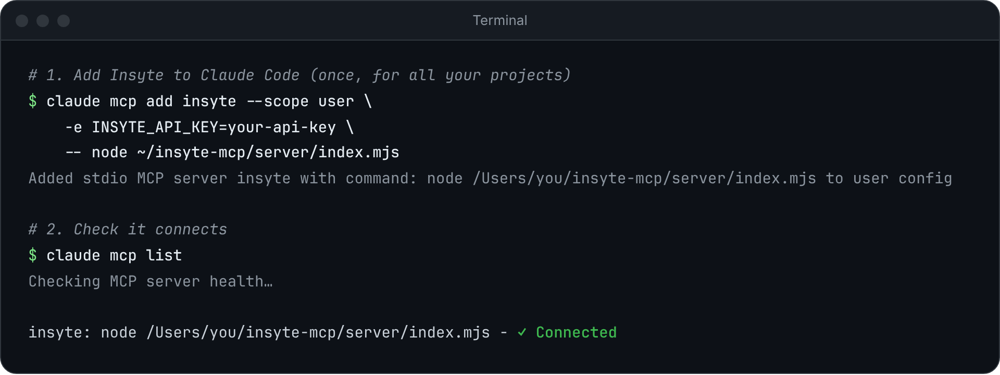

<p align="center">
  
</p>

<p align="center">
  <a href="#step-2-install-in-claude"><b>Download</b></a> ·
  <a href="#step-1-create-an-api-key-in-insyte">Setup guide</a> ·
  <a href="#troubleshooting">Troubleshooting</a> ·
  <a href="#for-developers">For developers</a>
</p>

Insyte MCP connects Claude to your Insyte Web system so you can ask questions about your business in
plain English and get answers from live data. It can only **read**: it never creates, changes or
deletes anything in Insyte.

**Things you can ask**

- "How many quotes did we raise last month, and how many became orders?"
- "Show me every open job for Smith Building Co with its stage, sales rep and ETA."
- "Which opportunities from the website came in this week, and who are they assigned to?"
- "List the job lines on job 48213 with product, size and price."
- "Which invoices are past their due date and still open?"

<p align="center">
  
</p>

## Before you start

Tick these off first. Most setup problems come from one of them.

| | You need | Why |
|---|---|---|
| ☐ | **Insyte Web, Professional edition**, with the API turned on | The Insyte API is only included in Professional. If **Api Integration** is missing under Settings → Integration, contact Accent Software support. |
| ☐ | Someone with the **Feature Allow Setup** permission | Only they can create API keys. |
| ☐ | **Claude Desktop** (Mac or Windows) **or Claude Code** | Claude on the web and on phones can't run this yet. |
| ☐ | For Claude Code only: **Node.js 20 or later** | Check with `node --version`. Get it from [nodejs.org](https://nodejs.org). Claude Desktop doesn't need it. |

> [!NOTE]
> On Claude Team and Enterprise plans, an organisation admin can turn off desktop extensions. If you
> can't find **Extensions** in Claude Desktop's settings, ask your Claude admin to allow them.

---

## Step 1: Create an API key in Insyte

*Done once by an Insyte admin. Each person can have their own key, or several people can share one.*

**1.1** Click your name in the top-right corner, then **Settings**.

<p align="center"></p>

**1.2** Scroll down, expand **Integration**, and click **Api Integration**.

<p align="center"></p>

**1.3** Click **New** and fill in the form:

| Field | What to enter |
|---|---|
| **Description** | Something you'll recognise later, e.g. `Claude – Sales team` |
| **Rep** | The Insyte user the key acts as. **Claude can see exactly what this user can see**, nothing more. |
| **Scope** | **READ** |

Click **Save**. Insyte creates the key. You can't change the Rep or Scope afterwards; delete the key
and make a new one instead.

<p align="center"></p>

**1.4** Back on the Api Integration page, click the **copy** icon on your key's card.

<p align="center"></p>

> [!IMPORTANT]
> Treat the key like a password. Don't email it or paste it into a chat; pass it on through a
> password manager. Anyone with the key can read everything its Rep can see.

> [!TIP]
> **Which Rep should I pick?** For one person, use their own user. To share across a team, create
> a dedicated Insyte user (for example "Claude Reports") with only the access the team should have,
> and use that.

---

## Step 2: Install in Claude

Pick the app you use. You only need one.

<table>
<tr>
<td width="50%" valign="top">

### 🖥️ Claude Desktop

The easy option: a file you double-click.

[Go to Claude Desktop setup ↓](#2a--claude-desktop)

</td>
<td width="50%" valign="top">

### ⌨️ Claude Code

One command in the terminal.

[Go to Claude Code setup ↓](#2b--claude-code)

</td>
</tr>
</table>

### 2A · Claude Desktop

<p align="center"></p>

1. Download **[`insyte-0.2.0.mcpb`](https://github.com/kylefetchoaccent/insyte-mcp/raw/main/downloads/insyte-0.2.0.mcpb)** (click the link; it downloads straight away).
2. **Double-click** the file. If that doesn't open Claude, drag the file onto the Claude Desktop window.
3. Claude shows the Insyte extension. Click **Install**.
4. Paste your API key into **Insyte API key**. Leave **API endpoint** and **API version** as they are.
5. Start a **new chat** and ask a question (see [Step 3](#step-3-try-it)).

<details>
<summary><b>Double-clicking didn't work? Install it from Settings instead</b></summary>

<br>

The menu names vary a little between Claude Desktop versions:

- **Newer versions:** Settings → **Desktop app** → next to **Extensions** click **Manage** →
  **Advanced settings** → **Install Extension…** → choose the `.mcpb` file.
- **Older versions:** Settings → **Extensions** → **Advanced settings** → **Install Extension…** →
  choose the `.mcpb` file.

Then continue from step 3 above.

</details>

<details>
<summary><b>When should I change the API endpoint?</b></summary>

<br>

You shouldn't need to. Left as `auto`, the extension tries each Insyte region and keeps the one that
accepts your key. If Claude reports that Insyte rejected a key you know is right, copy the
**API Endpoint** shown at the top of your Api Integration page with the copy icon and paste it into
**API endpoint**.

<p align="center"></p>

</details>

### 2B · Claude Code

1. Download **[`insyte-mcp-0.2.0.zip`](https://github.com/kylefetchoaccent/insyte-mcp/raw/main/downloads/insyte-mcp-0.2.0.zip)**
   and unzip it somewhere permanent, for example your home folder. You should end up with
   `insyte-mcp/server/index.mjs`.
2. Add your Insyte system. Pick a short name for it (`main` is fine) and paste your key when asked.
   The key doesn't show as you paste it. The command checks the key with Insyte, then stores it in
   your computer's credential store (Windows Credential Manager or the macOS Keychain), not in a file.

**Mac / Linux**

```bash
node ~/insyte-mcp/server/index.mjs add main
```

**Windows (PowerShell)**

```powershell
node "$HOME\insyte-mcp\server\index.mjs" add main
```

3. Connect it to Claude Code. No key goes in this command:

**Mac / Linux**

```bash
claude mcp add insyte --scope user -- node ~/insyte-mcp/server/index.mjs
```

**Windows (PowerShell)**

```powershell
claude mcp add insyte --scope user -- node "$HOME\insyte-mcp\server\index.mjs"
```

4. Check it connected:

```bash
claude mcp list
```

You should see **✓ Connected** next to `insyte`:

<p align="center"></p>

`--scope user` makes Insyte available in every folder you open Claude Code in. Leave it out to add
it to the current project only.

---

## Step 3: Try it

Open a **new** chat (Claude Desktop) or session (Claude Code) and ask something like:

> **How many jobs did we raise this month? Break them down by stage.**

The first time, Claude asks for permission to use the Insyte tools. Choose **Allow** (or **Always
allow** so it stops asking).

Claude works in three moves, and you'll see them in the chat:

1. **List the data sets.** It finds which Insyte data holds the answer (Jobs, Contacts, Invoices…).
2. **Describe the fields.** It checks the exact field names, so it doesn't guess.
3. **Query.** It fetches only the rows and columns it needs, then answers.

**Good questions to start with**

| Area | Try asking |
|---|---|
| Sales | "What's our quote-to-order conversion rate for the last 90 days, by sales rep?" |
| Customers | "Find the contact Jane Citizen and show her jobs and their status." |
| Jobs | "Which orders are waiting on supplier goods with an ETA in the past?" |
| Money | "List open invoices more than 30 days past their due date, with customer and invoice number." |
| Leads | "How many new opportunities did each lead source bring in this quarter?" |

> [!TIP]
> Name the time period and the details you care about. "Quotes raised since 1 July with customer
> name, sales rep and expiry date" gets a better answer than "recent quotes".

---

## Troubleshooting

| What you see | What it means | Fix |
|---|---|---|
| `Insyte API returned 401` or `403`, or `rejected INSYTE_API_KEY` | The key is wrong, deleted, or its user isn't licensed. If you changed **API endpoint**, it may point at the wrong region. | Copy the key again from Api Integration (Step 1.4) and reinstall, or create a new key. Set **API endpoint** back to `auto`, or paste the endpoint from your Api Integration page. |
| `Could not reach` followed by an Insyte address | No internet, or a firewall or proxy blocks the API | Check you're online. On a work network, ask IT to allow the API Endpoint shown on your Api Integration page. |
| `Left out …: Insyte cannot read these fields on this system` | Your Insyte database lacks columns the API expects | You still get the rest of each record. Tell Accent Software support which fields it names. |
| Claude says it has no Insyte tools | The chat was open before you installed | Start a **new** chat. If that doesn't help, quit Claude completely and reopen it. |
| No **Extensions** in Claude Desktop settings | Your Claude admin has turned extensions off | Ask your Claude admin, or use Claude Code instead. |
| `node: command not found` (Claude Code) | Node.js isn't installed | Install Node.js 20+ from [nodejs.org](https://nodejs.org), open a new terminal, and rerun the command. |
| Results are missing records you expect | The key's Rep can't see them in Insyte | Check that user's permissions in Insyte, or use a key for a user with wider access. |
| `Insyte API returned 400` | Claude wrote a query Insyte didn't accept | Usually Claude retries on its own. If not, rephrase the question or name the fields you want. |
| **Api Integration** isn't under Settings → Integration | Your edition doesn't include the API | Contact Accent Software support. |

Still stuck? In Claude Code, run `claude mcp get insyte` and include the output when you ask for help.
Remove the key from it first.

---

## Using more than one Insyte system

One install can read as many Insyte systems as you need, for example each client you support, or a
dealer's separate regions. Give each system a name and add its key once:

```bash
node ~/insyte-mcp/server/index.mjs add acme
```

```bash
node ~/insyte-mcp/server/index.mjs add acme-nz
```

Then start a new chat and name the system in your question: "In acme, how many open jobs are
there?" Claude passes the name to every lookup. When you have more than one system and don't say
which, Claude asks rather than guessing, so you never get one client's data in place of another's.

| To | Run |
|---|---|
| See your systems | `node ~/insyte-mcp/server/index.mjs list` |
| Check every key still works | `node ~/insyte-mcp/server/index.mjs test` |
| Remove a system and delete its key | `node ~/insyte-mcp/server/index.mjs remove acme` |

On Windows, use `"$HOME\insyte-mcp\server\index.mjs"` in place of `~/insyte-mcp/server/index.mjs`.

**Claude Desktop users:** download the zip from [step 2B](#2b--claude-code) and run the same `add`
commands. The extension reads systems from the same credential store, so they show up beside the
one in the extension's settings. That one is named by **Name for this system** (default `main`).

Ask "Which Insyte systems can you see?" to check what Claude has.

## Keeping data safe

- **Read-only.** The extension has no tools that create, change or delete anything.
- **Customer details go to Claude.** Results can include names, addresses and phone numbers. Pick
  the key's Rep so it only sees what the people using it should see.
- **Keys stay on your computer, encrypted.** Claude Desktop keeps the extension's key in the
  system's secure storage, and the `add` command stores keys in Windows Credential Manager or the
  macOS Keychain. No key is written to a settings file. The server only sends each key to the Insyte
  address it belongs to.
- **Lost laptop, or someone leaves?** Delete their key on the Api Integration page. It stops working
  within moments.

## Updating or removing

| | Claude Desktop | Claude Code |
|---|---|---|
| **Update** | Download the new `.mcpb` and install it over the old one | Unzip the new version over the old folder |
| **Remove** | Settings → Extensions → **Insyte** → Uninstall | `claude mcp remove insyte --scope user` |

Uninstalling leaves keys added with `add` in the credential store. Run `remove <name>` for each one
first, and delete the key in Insyte if nobody uses it.

---

## For developers

<details>
<summary><b>How it works</b></summary>

<br>

At startup the server reads the API's `$metadata`, so every data set the system exposes is available
with Insyte's own field descriptions and no per-entity code. API v2 exposes 32 to 37 data sets
depending on the region: Jobs, JobLines, Contacts, Companies, Opportunities, Invoices, Payments,
SupplyJobs, commissions and more. When the host offers API v3 (Insyte 26.3.0.0+) the server uses v3.

With `INSYTE_API_BASE` unset or `auto`, it tries each Insyte region at startup and keeps the one
that accepts the key. Insyte serves `$metadata` without a key, so only an authenticated request
shows which region holds the tenant.

Fields such as `Status` and `Stage` hold codes like `stage_job_quote`, while Insyte's descriptions
use plain words ("quote, order or lost"). `insyte_describe_dataset` samples the 300 newest records
and lists the codes it finds, so Claude filters on `Stage eq 'stage_job_quote'`.

Insyte has two faults the server works around. Some related-list routes return a cut-off body or a
404 for an empty single record; the server then fetches the same data by expanding the parent. Some
tenants' databases lack columns the API still maps (seen on `SupplyJobLines`); when a request names
no fields, the server finds those columns, leaves them out, and says so in the result.

| Tool | What it does |
|---|---|
| `insyte_list_datasets` | Every data set, with its description and what can be expanded or followed |
| `insyte_describe_dataset` | Fields (type and description), key, navigation properties and related lists |
| `insyte_query` | OData query: `select`, `filter`, `orderby`, `expand`, `limit`, `skip`, `count` |
| `insyte_get_record` | One record by ID |
| `insyte_get_related` | A related list from one record, e.g. `Jobs(123)/JobLines` |

Results are capped at 1,000 rows per call and trimmed to fit Claude's context, with `hasMore` and
`nextSkip` for paging. All tools are marked read-only.

</details>

<details>
<summary><b>Configuration</b></summary>

<br>

Systems come from the `add` command (keys in the OS credential store, names and hosts in
`~/.insyte-mcp/systems.json`) plus, optionally, one key passed by environment variable. The Claude
Desktop extension uses the environment variable and keeps the key in its own secure storage.

| Variable | Default | Notes |
|---|---|---|
| `INSYTE_API_KEY` | (none) | READ key from Api Integration. Optional when systems were added with `add` |
| `INSYTE_SYSTEM_NAME` | `main` | Name for the `INSYTE_API_KEY` system |
| `INSYTE_API_BASE` | `auto` | Endpoint for the `INSYTE_API_KEY` system. `auto` tries each Insyte region. Or paste the *API Endpoint* from the Api Integration page; a trailing `/v1`, `/v2` or `/v3` is fine |
| `INSYTE_API_VERSION` | `auto` | `v2`, `v3`, or `auto` (v3 when available) |
| `INSYTE_MCP_HOME` | `~/.insyte-mcp` | Folder for the systems registry |

Manual config for Claude Desktop (`claude_desktop_config.json`) or other MCP clients, after adding
systems with `add`:

```json
{
  "mcpServers": {
    "insyte": {
      "command": "node",
      "args": ["C:\\Users\\you\\insyte-mcp\\server\\index.mjs"]
    }
  }
}
```

> [!WARNING]
> Don't put `INSYTE_API_KEY` in a config file's `env` block. Those files are plain text, and
> Accent's password policy forbids storing credentials unencrypted. Use `add` instead.

Design notes, the security model, and the plan for a hosted claude.ai connector are in
[docs/technical.md](docs/technical.md).

</details>

<details>
<summary><b>Build, test and package</b></summary>

<br>

```bash
npm install
npm run build      # TypeScript → dist/
npm run package    # single-file bundle + release/insyte-<version>.mcpb (needs: npm i -g @anthropic-ai/mcpb)
```

```bash
INSYTE_API_KEY=... npm run smoke
```

`test/smoke.mjs` drives the server over stdio the way Claude does and prints each tool's output.
`node test/paging.mjs <metadata.xml>` runs it against a local mock API to check paging.

```bash
INSYTE_API_KEY=... npm run test:live
```

`test/live.mjs` asserts against a live tenant: every data set with and without `select`, every
related list, the codes in `insyte_describe_dataset`, paging, and error messages. It prints IDs and
counts, never record contents, and exits 1 on any failure.

```bash
INSYTE_API_KEY=... npm run test:systems
```

`test/systems.mjs` adds the key under two names in an isolated credential-store service, checks
`add`, `list`, `test` and `remove`, drives the server through both systems, then deletes the keys
and confirms they are gone.

</details>

<details>
<summary><b>Roadmap</b></summary>

<br>

- **Write actions:** create web leads, attach documents, Live Diary bookings. These need a READ-WRITE key
  and a confirmation step, so they are left out of this version.
- **Hosted connector:** add Insyte from claude.ai's connector settings, sign in, and manage
  systems there, with no download. Same tools as this version. Plan and open decisions in
  [docs/technical.md](docs/technical.md#hosted-connector-plan).
- **v3 field names:** check results once 26.3.0.0 reaches production, since v3 renames some fields.

</details>

<sub>Screenshots come from Insyte's own documentation. Names, API keys and endpoints are blurred.</sub>
